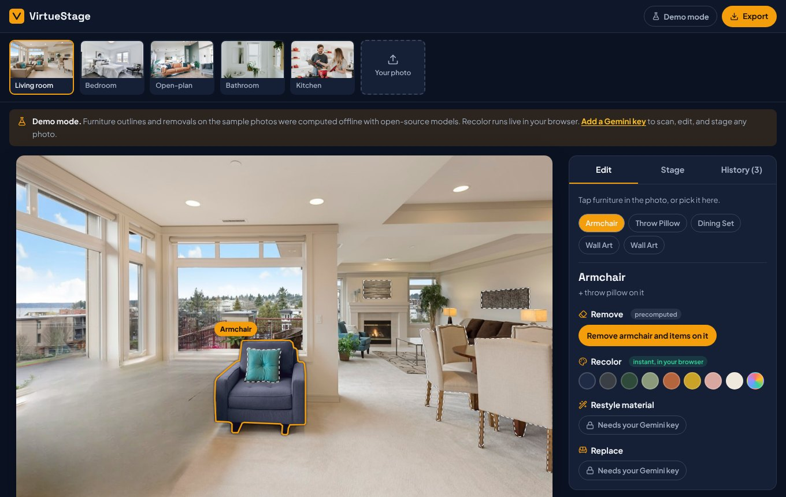
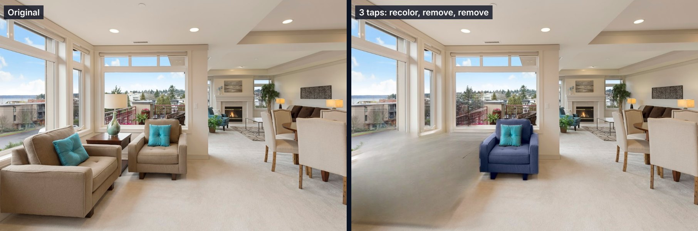

# VirtueStage

**Tap any piece of furniture in a listing photo to remove, recolor, restyle, or replace it. The AI only touches the pixels you tapped.**

Live demo: **https://mikecavallo.github.io/virtue-stage/**





VirtueStage is a static web app (no backend). Visitors without an API key get a demo on five sample photos. Visitors who paste their own Gemini API key can scan, edit, and stage any photo; requests go straight from their browser to Google.

## What it does

| | |
|---|---|
| **Segment** | Gemini 3.8 Flash returns a labeled polygon for every movable object. Items resting on furniture (pillows on a sofa, a vase on a table) are linked to it. |
| **Tap** | Hit-testing runs in the browser. The smallest object under the pointer wins, so you can grab a pillow without grabbing the sofa. |
| **Remove / restyle / replace** | Nano Banana 2.1 (`gemini-nano-banana-2.1`) receives the photo plus a copy with the object highlighted in magenta. |
| **Multi-select** | Shift-click (or the Select multiple toggle on touch) to grab several objects; one model call removes them all, one recolor paints them all. |
| **Polish** | Live removals already include cleanup in the same call (wider shadow margin, untouched neighbours masked out). Polish is an optional second pass over every edited area, and the way to clean up the demo's precomputed removals. |
| **Recolor** | Runs locally in CIELAB space: swaps chroma, keeps the original lightness variation, so fabric still looks like fabric. Instant and free. |
| **Match existing furniture** | Remove all but 1 to 3 pieces and the Stage tab offers to stage the room around them: the kept pieces go to the model as reference crops, and their pixels are pasted back afterwards so they stay exactly as photographed. |
| **Stage** | Six style presets × six room types, with prompts that spend most of their words on what must not change. |
| **Disclose** | Export stamps a "Virtually staged" or "Digitally altered" label (California AB 723), offers the original as a separate download, and writes a change log. |

## The architecture lock

The first version of this project asked an image model to stage the whole photo. It produced a nice room that wasn't the same room: new windows, new walls, a different view. In a real listing that is misrepresentation.

So the model never gets the final say over the whole frame:

1. **Object edits are masked.** The model's output is pasted back only inside the tapped object's outline, dilated to catch edges and contact shadows and feathered so the seam disappears. Every pixel outside is the original pixel. The end-to-end test asserts this.
2. **Drift check.** Before compositing, the app compares the model's output with the original *outside* the mask on small grayscale thumbnails. If the model zoomed, shifted, or recomposed the photo, it retries once and keeps the better attempt.
3. **Staging is checked.** Whole-room staging can't be masked, so Gemini 3.8 Flash compares before and after for changed walls, windows, doors, ceilings, or flooring. If it finds any, the app regenerates once with those problems listed in the prompt, and records the verdict in the history.

## Demo mode vs live mode

| | Demo (no key) | Live (your Gemini key) |
|---|---|---|
| Photos | 5 samples (one with a full declutter) | Samples or your own upload |
| Tappable | Every visible movable piece. A few big ones (e.g. the open-plan sofa) are outline-only: recolor works, removal needs live AI | Whatever Gemini finds |
| Object outlines | Precomputed offline with Grounding DINO + SAM | Gemini 3.8 Flash |
| Remove | Precomputed with LaMa | Nano Banana 2.1 + mask paste-back |
| Recolor | In-browser | In-browser |
| Restyle, replace, stage | Locked | Nano Banana 2.1 |

Cheap deterministic edits (demo removals, recolors) are *replayed* from the last AI-generated image instead of stacked, so they stay consistent with each other: recolor the armchair, then remove its pillow, and the fabric under the pillow comes out recolored too.

If the key expires or Google rejects it, the studio opens a key prompt instead of failing: on arrival (a free models-list call checks the stored key) or mid-edit, where **Save and retry** reruns the action that failed with the new key.

The API key is kept in `sessionStorage` (or `localStorage` if you tick "remember"), sent only in the `x-goog-api-key` header, and never touches any other server. Image models aren't on Gemini's free tier, so live edits need a key with billing enabled: roughly $0.05 per 2K edit with Nano Banana 2.1.

## Run it locally

```bash
cd app
npm install
npm run dev        # http://localhost:5173
npm test           # unit tests (Vitest)
npm run lint
npm run build      # static output in app/dist
```

Regenerating the demo data (optional, CPU is fine): see [`scripts/demo-assets/README.md`](scripts/demo-assets/README.md).

## Deploying

`.github/workflows/deploy.yml` lints, tests, builds, and publishes `app/dist` to GitHub Pages on every push to `main`. One-time setup: **Settings → Pages → Source: GitHub Actions**. The build uses a relative base path and hash routing, so it works under any repo name.

## Project layout

```
app/
  src/ai/          gemini.js (REST client), prompts.js, tasks.js (one call per task), pipeline.js (mask, generate, drift check, paste back)
  src/lib/         geometry.js (polygons, hit-testing, child links), pixels.js (blur, CIELAB, recolor), canvas.js
  src/studio/      editor overlay, inspector, history/replay, dialogs
  src/pages/       Landing.jsx, Studio.jsx
  public/samples/  sample photos, precomputed inventories and removal patches
scripts/demo-assets/  offline pipeline that builds the demo data
```

## Limits

- Replacements are generative, so a new sofa can come out slightly different in scale or lighting from what you pictured. Removals are far more reliable.
- Gemini's polygons are coarser than SAM masks; fine edges (chair legs, plant leaves) can keep a few stray pixels.
- The architecture check is a model judging a model. It catches gross changes (a new window) more reliably than subtle ones (a slightly moved outlet).
- AB 723 also requires a link to the unaltered photo. A static app can't host that for you, so export gives you the original to post alongside.

## Roadmap

- **Whole-listing intelligence.** Group a listing's photos by room, link the same sofa across angles, and apply one edit to every photo of that room.
- **3D room model.** Feed each room's photos to a feed-forward reconstruction model (e.g. MapAnything) for camera poses and an overhead floor view with furniture footprints, and use it for scale checks and consistent multi-angle staging.

## Credits

- Gemini API (Google) for live segmentation, editing, and staging.
- Grounding DINO, Segment Anything, and LaMa for the offline demo data. Models and licenses are listed in `scripts/demo-assets/README.md`.
- Kitchen photo by Terry Magallanes on Pexels (Pexels License). The other sample photos were carried over from the original version of this repo; see `scripts/demo-assets/README.md`.

Built by [mikecavallo](https://github.com/mikecavallo). Not affiliated with Google.
